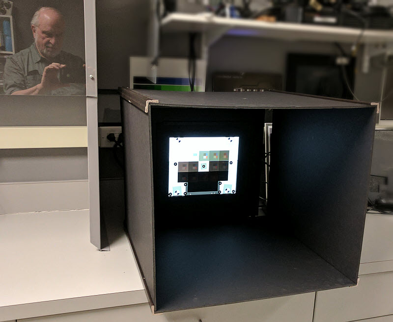
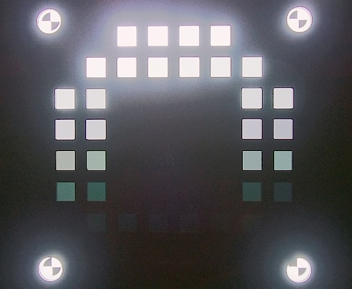

# 06 动态范围、层次与 HDR 视频

> 目标：能把“逆光人脸黑、天空白、开 HDR 后变灰”拆成采集、处理和显示问题。本章以手机最终视频为主；下面的场景与实验步骤是教学方案，不代表任何厂商内部验收标准。

## 1. 首先区分三个问题

**场景动态范围**是场景最亮与最暗有效区域的亮度比；**相机可用动态范围**是按明确噪声、对比度或细节判据仍能保留的明暗跨度；**HDR 视频格式**描述信号如何编码、传递和显示。一个 SDR 文件也可能通过色调映射保留较大场景跨度，一个标为 HDR 的文件也可能已经丢失高光纹理。

动态范围以档数表达时，可写成 $DR=\log_2(L_{max}/L_{min})$。这里的两个亮度必须来自同一测量定义，不能用压缩后的最大/最小像素值直接代入。测最终视频时，结果包含镜头杂散光、传感器、融合、降噪、色调映射和编码的共同作用，不能命名为“传感器原生 DR”。[1]

对手机而言，学习重点有四项：亮处是否保留层次、暗处是否还有可用信息、主体是否自然、明暗关系在时间上是否稳定。HDR 格式支持与预览/编码配置可参考 Android 的公开接口；它说明应用能如何请求和输出 HDR，不公开各品牌相机的内部调校策略。[2]

## 2. 评价项与指标

| 评价项 | 建议记录 | 判断边界 |
|---|---|---|
| 高光保留 | 高光纹理、有效灰阶、饱和区域及持续时间 | 反光点本来可能超出范围；不能要求所有点光源都不溢出 |
| 暗部可用性 | 暗部信号、噪声、低对比纹理可辨性 | 提亮后的“看得见”不等于真实信息增加 |
| 亮度层次 | 已标定灰阶的响应曲线、相邻灰阶分离 | 局部映射会使同一亮度在不同背景下得到不同输出 |
| 可用 DR | 图卡标定值、判据、软件算法及版本 | 不混用 RAW、最终视频和不同 SNR 判据的档数 |
| 时域映射 | 固定/跟踪 ROI 的亮度随时间变化、过渡时间 | 先排除 AE、AWB、光源变化与 ROI 漂移 |
| HDR 运动缺陷 | 运动边缘重影、轮廓破碎、亮暗交界闪变 | HDR 开关可能联动帧率、防抖、快门和摄像头 |

Imatest 的公开资料说明透射式图卡、噪声/对比度判据以及杂散光都会影响动态范围测量。[1] 实操先固定一种定义，保留原始报告与设置，再比较版本差异。若只能拍自然逆光场景，报告“高光纹理保留改善”等现象即可，不编造多少档动态范围。

## 3. 实验室搭建和官方配图

图：Imatest 官方动态范围资料中的遮光实验搭建。用于理解反射与杂散光控制，图卡图片不能打印替代标定图卡。[页面出处](https://www.imatest.com/imaging/dynamic-range/) · [原图地址](https://www.imatest.com/wp-content/uploads/2016/10/contrast_res_box_setup_800W.jpg)。图片版权归原权利方，下载日期 2026-10-26。

图：亮块附近的光污染会改变暗部测量；来源同上，[原图地址](https://www.imatest.com/wp-content/uploads/2016/04/masked_36_patch_flare.jpg)。这是官方教学示例，不是本次手机实测结果。

建议流程：校验光箱与图卡参考文件 → 控制反射与取景 → 固定手机模式 → 等控制系统稳定 → 录制原片 → 选择稳态帧和动态过程分别分析。保留镜头是否清洁、环境照明、图卡占画比例、相机距离。若允许锁 AE/AWB/AF，另外拍一组锁定样本帮助拆解机制，但产品体验仍要测默认自动模式。

## 4. 手机测试用例

以下亮度分级与动作是自建测试建议；正式版本需实测照度/亮度并记录，不能仅写“亮/暗”。每例至少重复三次作为入门练习，重复次数不是统计充分性的保证。

| 用例 | 条件与动作 | 关注项与证据 |
|---|---|---|
| HDR-01 静态图卡 | 三脚架固定，透射式灰阶图卡，统一构图录制 | 原片、灰阶 ROI、可用范围判据、软件报告 |
| HDR-02 逆光人像 | 人脸与窗外同框；保持位置，拍 SDR/HDR 两组 | 人脸、窗外纹理、肤色与自然对比；避免只比较天空 |
| HDR-03 明暗穿越 | 人物从背光区进入亮区，按地面标记重复 | 人体边缘重影、局部提亮迟滞、亮度跳变的时间点 |
| HDR-04 亮物入画 | 相机固定，亮灯/白板从边缘进入画面再退出 | 暗部是否抬升、映射抽动，区分眩光与算法反应 |
| HDR-05 夜景高光 | 同框拍招牌、暗部墙面与行人 | 招牌色彩和字形、暗部纹理、运动重影、噪声 |
| HDR-06 跨端观看 | 同一原片在已知 HDR 链路及 SDR 映射链路播放 | 文件哈希、播放端、显示设置；确定差异出在哪个环节 |

## 5. 如何看结果与定位

先正常速度观看整体，再看高光、脸部、暗部三个 ROI；对比同一主体经过亮暗区域的全过程。结果可以组织为“静态层次合格，亮物入画后暗部抬升并持续若干帧”，比“动态范围不好”更容易复现。

若原片在某播放器正常、另一播放器发灰，先查传递函数、色彩解释和映射；若所有正确播放端都丢失同一高光纹理，才进一步查采集和处理。BT.2100 是 HDR 电视信号体系的标准入口，不是手机逆光人像的统一验收门槛。[3] DXOMARK 商业实验室明确列有 HDR 视频分析，但这不等于其公开榜单新增一个名为 HDR 的独立评分属性。[4]

## 6. 自主练习

用同一手机录制逆光人物的 SDR/HDR 各三段，保留实际文件参数。交付一张对照表：主体亮度、高光纹理、暗部纹理、运动重影、时域稳定性、播放链路。每项附一个时间点及截图；结论写清“本模式、本场景”，不外推所有视频。

## 7. 学习资料与阅读顺序

1. [Imatest：Dynamic Range](https://www.imatest.com/imaging/dynamic-range/)：先读定义、图卡和杂散光限制，再读测量细节；适合建立客观测量边界。
2. [Android：HDR video capture](https://developer.android.com/media/camera/camera2/hdr-video-capture)：重点读设备能力检查、HDR 格式、编码颜色配置；适合理解第三方应用测试。
3. [ITU-R BT.2100](https://www.itu.int/rec/R-REC-BT.2100)：查 PQ/HLG 信号体系与标准版本；不必第一遍就推导全部公式。
4. [DXOMARK × CIVIT：图像质量服务](https://corp.dxomark.com/catalog/services/custom-testing/dxomark-civit-joint-lab-finland-camera-testing/)：查看 Video IQ 中 HDR、时域噪声与控制收敛的测量范围。
5. [Apple：更改视频录制设置](https://support.apple.com/en-ie/guide/iphone/iphc1827d32f/ios)：理解 HDR 开关、自动帧率等产品设置；具体机型以对应系统手册为准。

关联：[05 空间噪声与时间噪声](05空间噪声与时间噪声.md) · [13 编码、HDR 输出与播放链路](13编码HDR输出与播放链路.md) · [返回目录](README.md)
