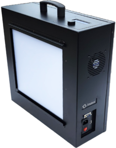

# 10 抗频闪与条带

> 目标：面对室内灯、舞台灯、LED 招牌和拍屏场景，能区分光源闪烁、AE 波动、滚动条带及编码色带，并设计可重复测试。

## 1. 频闪从哪里来

光源亮度可能随时间调制。相机对每行在一个曝光窗口内积分；当各行、各帧采样到的光量不同，就可能看到横向明暗条带、整帧亮度变化或光源忽明忽暗。人眼觉得稳定的灯，也可能被相机拍出明显闪烁。[1]

对简化线性曝光，可把某行输出看成 $S(y,t)\propto\int_{t+y\tau}^{t+y\tau+T}L(u)\,du$：$T$ 是曝光时间，$\tau$ 是行间时间偏移。它只用于解释机制，未包含多曝光 HDR、非线性色调映射及空间处理。

市电频率不是所有灯具的实际光调制频率。部分灯有倍频成分，PWM 频率与占空比也可能由驱动器决定。“50 Hz 环境就固定一个快门全部解决”并不可靠；混合光、拍屏与 HDR 短曝光分量都可能使情况更复杂。Imatest 的研究特别讨论了光源频率、占空比、曝光方案、帧率与读出时间如何共同影响采样。[2]

## 2. 不要混淆的现象

| 现象 | 优先检查 | 对照办法 |
|---|---|---|
| 整帧周期性变亮变暗 | 光源波动、曝光控制、帧率关系 | 用稳定参考光、记录实际曝光，拍锁曝光对照 |
| 横向滚动暗带 | 调制光与滚动读出相互作用 | 更换光源或调频，观察条带位置/速度变化 |
| 局部招牌消失 | LED 短脉冲与采样窗口错位 | 改变曝光、相位与采样时长，记录招牌独立 ROI |
| 人脸进出时亮度跳 | AE/局部映射或光源反射改变 | 控制场景内容后再看是否仍有周期性 |
| 渐变天空分成色阶 | 位深、量化或压缩色带 | 在稳定光源下复现，并检查转码/输出链路 |
| 屏幕扫描条纹 | 显示刷新/PWM与相机采样 | 记录屏幕亮度/刷新率，不仅记录房间灯光 |

## 3. 测量项与搭建

固定手机与均匀目标，建立光源、曝光和输出三类记录。光源至少记录实际频率、占空比、波形/调光方式、平均亮度；若无法测得，写“未知”，不要拿产品名称当波形证据。曝光记录请求值与实际值的区别，能取到元数据时同时保留。

图：Imatest 公开资料所示的可控频闪光源设备，用于理解“可控输入”而非仅凭肉眼判灯光稳定。[页面出处](https://www.imatest.com/imaging/flicker/) · [原图地址](https://www.imatest.com/wp-content/uploads/2024/06/HighIlluminationFlickeringLightbox-235x300.png)。图片版权归原权利方；2026-10-26 下载，非本次实验设备照片。

| 测量项 | 计算或观察 | 适用限制 |
|---|---|---|
| ROI 时间亮度 | 每帧均值曲线、频谱与峰峰值 | 固定场景并检查配准；AE和内容变化会污染 |
| 相对波动 | 教学量 $A=(Y_{max}-Y_{min})/(2\bar Y)$ | 非标准通用评分；近黑区域分母过小，不宜使用 |
| 行方向条带 | 每帧逐行均值、去除静态照明不均后比较 | 不把真实水平纹理当条带；ROI不能横跨运动主体 |
| 条带动态 | 位置、宽度、速度、持续时长 | 不同取景和裁切下像素速度不可直接比较 |
| 控制恢复 | 换光源后稳定时间、是否反复切换 | 稳态和过渡分开统计 |

输出域的编码值统计只用于同一颜色/传递函数条件下的比较，不应直接解释为绝对光学调制深度。记录足够长序列并改变起始相位；恰好同步的短片可能漏掉最差相位。[2]

## 4. 手机测试用例

| 用例 | 条件与动作 | 证据 |
|---|---|---|
| FL-01 均匀光基线 | 稳定直流光照亮灰板，固定相机 | 亮度曲线与条带基线，确认分析流程不会误报 |
| FL-02 频率扫描 | 可控 LED 逐档改变调制频率，平均亮度尽量一致 | 每档参数、实际曝光、帧率、波动/条带结果 |
| FL-03 占空比扫描 | 相同频率改变占空比，记录平均/峰值变化 | 不能把亮度变化与抗频闪能力混为一谈 |
| FL-04 自动检测 | 明亮稳定光切到调制光，反向再做 | 检测迟滞、曝光调整与恢复时间 |
| FL-05 混合光 | 两种不同调制光分别照亮画面两区 | 分区 ROI；可能无法同时消除全部闪烁 |
| FL-06 HDR对照 | 同一 LED 场景拍 SDR/HDR | 短曝光分量相关条带、融合异常；核对其他设置 |
| FL-07 拍屏 | 显示固定灰阶/画面，改变屏幕亮度与刷新率 | 屏幕设置、相机设置、扫描条纹与摩尔纹分别记录 |

以上为教学方案，频率点和观察时长应按设备能力、目标市场光源和产品需求制定，不提供统一“通过百分比”。

## 5. 从公开接口理解厂商行为

Android Camera2 提供 `CONTROL_AE_ANTIBANDING_MODE`，可查询/请求支持的抗条带模式；公开定义用于理解自动曝光如何考虑灯光频率。[3] 手动曝光下不能假定该自动机制继续代替测试者选择快门。原生相机可能还有未公开策略，因此“接口存在某模式”不等于某品牌所有视频模式都启用同一算法。

DXOMARK 商业实验室也列出 LED 闪烁计时测量，Image Engineering 提供可控频闪光源资料。[4][5] 这些证据说明可以客观测试，不代表公开了手机厂商完整判定阈值。

## 6. 自主练习

找两盏不同灯具和一块屏幕，先记录可知设置，再拍默认视频、锁曝光视频及不同帧率。每段给出“整帧波动/条带/局部闪烁/未观察到异常”的分类，并说明光源频率未知时结论的局限。至少做一次长于初次样本的复拍，检查是否漏掉缓慢拍频。

## 7. 学习资料

1. [Imatest：Flicker](https://www.imatest.com/imaging/flicker/)：建立灯光调制、滚动读出与可见现象的联系。
2. [Imatest：Describing and Sampling the LED Flicker Signal](https://www.imatest.com/2020/03/describing-and-sampling-the-led-flicker-signal/)：附原始论文与演示资料；重点看参数、相位及采样覆盖。
3. [Android CaptureRequest：CONTROL_AE_ANTIBANDING_MODE](https://developer.android.com/reference/android/hardware/camera2/CaptureRequest#CONTROL_AE_ANTIBANDING_MODE)：看支持模式和生效边界，别只背 50/60 Hz 名称。
4. [DXOMARK × CIVIT：测试服务](https://corp.dxomark.com/catalog/services/custom-testing/dxomark-civit-joint-lab-finland-camera-testing/)：查 Timing Measurements 中 LED flickering，区分商业能力与榜单属性。
5. [Image Engineering：LG3 数据表](https://www.image-engineering.de/content/products/equipment/illumination_devices/lg3/downloads/LG3_data_sheet.pdf)：了解可变频闪光源如何支持受控实验；参数以对应设备版本为准。

关联：[01 曝光与视频 AE](01曝光与视频AE.md) · [08 运动还原与滚动快门](08运动还原与滚动快门.md) · [返回目录](README.md)
