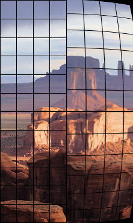

# 11 光学、采样与处理伪影

> 学习目标：能够准确描述异常形状、出现位置与随时间的变化，并通过受控对照区分光学、采样、处理和编码候选原因。本章的实验编排为教学建议，不是手机厂商内部验收标准。

## 1. 手机视频为什么需要单列伪影

手机通常同时进行畸变校正、锐化、降噪、融合、电子防抖与编码。同一个可见异常可能经过多个环节共同形成。测试报告首先记录“什么条件、哪个区域、什么形状、持续多久”，再讨论原因。DXOMARK 将 Artifacts 列为视频属性之一，但本章将其拆成便于定位的类别，不能把这些类别当成各自独立的官方评分项。[来源：DXOMARK 视频属性](https://www.dxomark.com/what-we-test-camera/)

| 类别 | 典型现象 | 手机视频尤其要关注 |
|---|---|---|
| 几何异常 | 桶形/枕形/波浪畸变、边缘拉伸 | 超广角、人脸靠近边缘、EIS 后局部形变 |
| 色差与色边 | 高反差边缘出现分离的彩边 | 画面四角、逆光枝条；区别于过曝紫边和伪色 |
| 眩光与鬼影 | 黑位抬升、雾化、光斑、彩色反射 | 夜间路灯、光源入出画、镜头盖板污渍或保护膜 |
| 采样混叠 | 摩尔纹、锯齿、伪色、细线爬动 | 衣物、栅栏、砖墙、拍屏；运动时可能更显眼 |
| 处理异常 | 光晕、过冲、塑料感、局部涂抹 | 人脸与背景处理不一致、跨帧细节闪变 |
| 编码异常 | 块边界、蚊噪、振铃、色带 | 复杂运动、高噪声夜景和二次转码 |

## 2. 先掌握三个区别

**光学畸变与透视变化不同。**用手机仰拍建筑出现上窄下宽，不能直接判成镜头畸变。畸变测量需校正图卡姿态并明确模型。Imatest 的 Checkerboard、Dot Pattern 等模块可用于几何分析，不同模型或 TV distortion 定义的数值不能直接混比。[Imatest 畸变说明](https://www.imatest.com/imaging/distortion/)

*读图：左侧为原始示例，右侧为桶形畸变示例；关注直线弯曲，而不是把所有边缘人物变形都归为同一机制。图片版权归 Imatest/原权利人，教学引用，非本机实测。来源：[页面](https://www.imatest.com/imaging/distortion/)｜[原图](https://www.imatest.com/images/Hunts_distortion.jpg)，下载日期 2026-10-26。*

**摩尔纹与频闪条带不同。**摩尔纹与纹理采样相关，改变距离、角度和输出尺寸通常会改变纹样；灯光频闪则需结合光源调制和读出分析。拍屏可能同时出现两者。[Imatest 摩尔纹](https://www.imatest.com/imaging/moire/)

**边缘“锐”不等于纹理真实。**锐化可以增强高对比边缘，同时降噪抹掉低对比纹理；因此 MTF 数值变好时，仍要观察皮肤、织物和草地的自然程度。[Imatest 处理伪影](https://www.imatest.com/imaging/artifacts/)

## 3. 测什么、如何量化

| 测量项 | 证据或单位 | 必须控制与说明 |
|---|---|---|
| 几何畸变 | 指定定义的百分比、网格残差 px | 图卡平整、姿态、距离、校正开关和有效视场 |
| 横向色差 | 通道边缘位移/面积色差，px 或归一化值 | ROI 距中心位置、边缘方向；不能等同所有紫边 |
| 眩光 | 光源角度—异常强度曲线、鬼影位置/面积 | 光源亮度/角尺寸、曝光、黑位；使用规范时注明版本 |
| 锐化光晕 | 边缘剖面、过冲/欠冲比例 | 避免边缘剪切；对比度、伽马和缩放必须一致 |
| 摩尔纹 | 标准图卡频段分析、色度异常及可见性记录 | 距离、对焦、频率单位和输出分辨率 |
| 时间稳定性 | 异常出现帧、持续时间、面积随时间变化 | 用原始呈现时间戳，配准前后结果分开保留 |

Imatest 对横向色差给出通道边缘分析方法；中心区域与错误边缘方向可能让测量失去代表性。[横向色差测量](https://www.imatest.com/imaging/chromatic-aberration/)

## 4. 可执行的手机测试场景

以下用例先各重复三次用于学习；次数是教学起点，应按实际波动和项目要求增加。

| 用例 | 条件与动作 | 记录与证据 |
|---|---|---|
| AR-01 超广角网格 | 固定机位拍平整网格，再分别启停防抖 | 网格残差、裁切、四角变化，记录模式支持情况 |
| AR-02 织物摩尔纹 | 恒定照明，对条纹衣物缓慢靠近/远离 | 异常开始距离、伪色 ROI、正常速度可见性 |
| AR-03 逆光色边 | 树枝/栏杆对亮背景，小幅改变构图 | 中心与角落对照；曝光和剪切比例 |
| AR-04 夜灯鬼影 | 清洁镜片，围绕固定点光源缓慢转动 | 光源角度、鬼影轨迹、黑位抬升及重复性 |
| AR-05 人脸边缘 | 人从画面中央移到边缘，固定距离 | 人脸宽高变化、背景线条、局部处理跳变 |
| AR-06 高反差文字 | 静态与横移各拍一段 | 边缘过冲、振铃和运动时扩散范围 |
| AR-07 高纹理运动 | 树叶/流水缓慢与快速摇摄 | 原片及转码版对照，块效应和纹理损失 |

## 5. 定位顺序

1. 清洁镜片并移除可疑保护膜，记录前后差异；不要同时更换多个设置。
2. 判断异常在原片中是否存在；仅播放器或社交软件出现时，先查输出链路。
3. 静止拍摄与运动拍摄对照，判断空间固定问题还是时域问题。
4. 改变距离、角度、焦段及防抖设置，观察异常是否跟随镜头、场景或画面坐标。
5. 能获取调试流时再比较处理前后；若只能拿最终视频，结论保持为“疑似某环节”。

例：转镜头时出现绿点，应记录其与光源的位置关系；若静态也存在、随角度移动，支持鬼影假设，但单凭颜色不能证明某层镀膜缺陷。颜色闪烁既可能来自摩尔纹，也可能来自 AWB，需看是局部细纹理还是全画面共同变化。

## 6. 自主练习与交付物

选“衣物摩尔纹”和“夜灯鬼影”各做一组对照。交付完整视频、异常时间段、带坐标 ROI、拍摄参数、至少一个替代解释及其排除证据。主观判断先在预期观看尺寸正常播放，再用放大逐帧解释原因；不能用最坏一帧替代发生率。

## 7. 推荐阅读顺序

1. [Imatest Artifacts](https://www.imatest.com/imaging/artifacts/)：先理解降噪、锐化与指标之间的冲突。
2. [Imatest Color Moiré](https://www.imatest.com/imaging/moire/)：学习采样造成的伪色及适用图卡。
3. [Imatest Distortion](https://www.imatest.com/imaging/distortion/)：阅读模型、图卡及数值定义，不急着背公式。
4. [Imatest Chromatic Aberration](https://www.imatest.com/imaging/chromatic-aberration/)：重点读 ROI 方向、位置和横向/纵向色差区别。
5. [Imatest Stray Light](https://www.imatest.com/imaging/straylight/)：认识受控光源、角度扫描与分析输出。
6. [DXOMARK 视频测试说明](https://www.dxomark.com/what-we-test-camera/)：理解伪影在整机评测中的位置。

[返回学习索引](README.md) · 关联：[运动与滚动快门](08运动还原与滚动快门.md)、[编码与播放](13编码HDR输出与播放链路.md)
