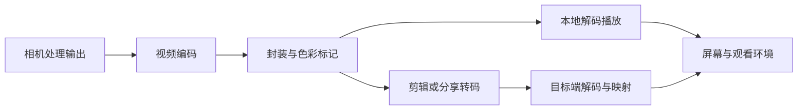

# 13 编码、HDR 输出与播放链路

> 学习目标：判断问题首先出现在哪个环节，并建立“原片—编辑—分享—播放”的可追溯对照。采集动态范围见第 06 章；本章关注它如何被编码、标识、转换和显示。

## 1. 先画清文件经过的路径



同一个“偏灰”现象，可能来自采集曲线，也可能是 HDR 被按 SDR 解释；同一个“细节差”现象，可能在相机降噪阶段出现，也可能由上传后的重编码造成。每个节点保留文件或可取得的调试输出，才能定位首次异常。

Android HDR 采集文档明确要求编码时设置适合的 profile、色彩标准、范围和传递函数；设置错误可能造成灰雾或颜色剪切。[Android HDR video capture](https://developer.android.com/media/camera/camera2/hdr-video-capture)

## 2. 必须掌握的概念

| 概念 | 对测试的意义 |
|---|---|
| 编码与容器 | H.264/HEVC 等描述视频压缩；MP4/MOV 组织流与时间信息，扩展名不等于编码格式 |
| 码率与复杂度 | 相同平均码率下，树叶、水面、噪声和快速运动可能更难编码；跨编码器不能单比码率 |
| 位深 | 更多量化级可降低量化风险，但“10-bit”不保证真实细节、动态范围或无色带 |
| 色度采样 | 影响彩色细线与文字边缘；需记录像素格式，不能只记录亮度分辨率 |
| 色彩标记 | primaries、transfer、matrix、range 共同决定数字如何被解释 |
| PQ/HLG 与元数据 | 是输出体系的一部分，需匹配解码和显示；不能只凭“HDR”开关验收 |
| 时间戳与重排 | PTS 表示呈现顺序，DTS 用于解码顺序；有重排时不可混用 |

HDR10、HDR10+、HLG 与 Dolby Vision 的具体支持随平台变化；不要把 Android 示例支持的格式表泛化为所有手机。格式与元数据合法，也不证明画面内容已经实现预期 HDR 效果。

## 3. 先做元数据检查，再做观看与量化

下面命令仅为读取样片的示例，需要本机已有 FFprobe。示例文件名须替换为实际路径，不会修改视频。

```powershell
ffprobe -v error -select_streams v:0 -show_entries stream=codec_name,profile,width,height,pix_fmt,avg_frame_rate,r_frame_rate,bit_rate,color_range,color_space,color_transfer,color_primaries:format=duration,size,bit_rate -of json "原片.mp4"
```

继续定位时可输出帧级信息：

```powershell
ffprobe -v error -select_streams v:0 -show_frames -show_entries frame=best_effort_timestamp_time,pkt_duration_time,pict_type,key_frame -of json "原片.mp4"
```

字段是否存在取决于文件和 FFmpeg 版本；`best_effort_timestamp_time` 可能是估计结果，不是相机采集时刻；平均帧率也不足以证明无掉帧。HDR 动态元数据可能需要专门解析器，不能因为上述输出没显示就断言不存在。[FFprobe 官方文档](https://ffmpeg.org/ffprobe.html)

## 4. 指标的适用范围

| 指标/方法 | 适合回答的问题 | 不足与前提 |
|---|---|---|
| 平均/分段码率 | 复杂片段是否存在码率分配变化 | 码率不等于质量；短时间统计还受 GOP 分配影响 |
| PSNR | 同一参考经过处理后的像素误差 | 同源、时间与空间对齐、范围和颜色解释一致 |
| SSIM | 同源图像结构保真程度 | 不直接代表自然度和全部时域缺陷 |
| VMAF | 匹配使用场景的编码/传输质量比较 | 需正确参考、模型、分辨率与观看假设；不能当手机相机总分 |
| 色带与块效应观察 | 渐变天空、暗部及复杂运动可见缺陷 | 应正常尺寸播放，再放大定位；显示链本身也可能产生色带 |
| 端到端对照 | 输出是否符合预定 HDR/SDR 目标 | 同一受控显示条件，避免自动亮度改变判断 |

Netflix 的 VMAF FAQ 讨论分辨率、参考视频与版本等使用条件。两部手机拍摄的不同构图、曝光、时序视频不能直接互作“无失真参考”。本章推荐先用一份原片生成不同转码版本练习，结论仅针对转码损失。[Netflix VMAF FAQ](https://github.com/Netflix/vmaf/blob/master/resource/doc/faq.md)

## 5. 手机测试场景

| 用例 | 条件与操作 | 留存证据与关注点 |
|---|---|---|
| OUT-01 静态渐变 | 拍天空/灰阶渐变，保留原片 | 位深、色带位置；不同显示器对照 |
| OUT-02 高纹理运动 | 树叶、水面、细碎灯光，固定运动路线 | 分段码率、纹理涂抹、块效应与关键帧附近变化 |
| OUT-03 夜景噪声 | 同场景不同照度录制 | 噪声与编码相互作用，不把全部“脏”归 ISP |
| OUT-04 HDR 跨端 | 本机、另一部支持设备、SDR 目标分别播放 | 保留同一原文件、播放器版本、显示设置 |
| OUT-05 剪辑导出 | 原片简单裁剪，分别选择保 HDR 与转 SDR | 输出格式/标记/高光/肤色，不以缩略图判断 |
| OUT-06 分享链路 | 通过目标应用上传下载，记录设置 | 文件是否转码、分辨率/码率/颜色变化 |
| OUT-07 混合素材 | HDR 与 SDR 片段加 SDR 字幕导出 | 片段交界亮度、字幕白色、目标色彩空间 |

Media3 Transformer 提供保留 HDR 和映射至 SDR 的路径，并说明平台支持和失败回退条件。因此测试需要记录“实际输出采用了哪条路径”，不能只记录用户选择了 HDR。[Android tone mapping](https://developer.android.com/media/media3/transformer/tone-mapping)

## 6. 常见误判与定位

- **截图发灰就判视频发灰**：截图过程可能已改变 HDR 解释；先用正常视频播放链复核。
- **标签写 BT.2020 就判正确**：标签与实际样本可能不匹配，仍需测试图样或已知内容。
- **文件更大就判更好**：先统一内容、时长、编码、帧率和尺寸，再看视觉质量。
- **跨端颜色不同就判相机偏色**：保留原片散列值，确定文件未变，再逐项固定播放器、显示和映射策略。
- **转封装必然无损**：只复制压缩码流时通常不发生图像重编码，但容器/元数据变化仍可能影响播放解释。

华为官方录像帮助同时提示 HDR Vivid 和高效视频格式的播放兼容性，并说明某项设置改变可能影响其他设置。这可以转化成兼容性与组合测试需求，不能由此推断其内部验收流程。[华为 Record Videos](https://consumer.huawei.com/en/support/content/en-us15957409/)

## 7. 练习与阅读资料

练习：选一段包含人脸、窗外高光和暗部的原片，保留原片、剪辑导出、分享下载三份文件。整理参数表、可见差异和首次发生差异的节点。没有可靠参考与显示条件时，只报告观察，不给伪精确的质量分数。

1. [Android HDR video capture](https://developer.android.com/media/camera/camera2/hdr-video-capture)：重点读编码初始化、传递函数与格式支持。
2. [Android Transformer tone mapping](https://developer.android.com/media/media3/transformer/tone-mapping)：理解保 HDR、映射 SDR 和错误解释的区别。
3. [FFprobe Documentation](https://ffmpeg.org/ffprobe.html)：掌握 `show_streams`、`show_frames`、`show_entries`，认识元数据证据边界。
4. [Netflix VMAF FAQ](https://github.com/Netflix/vmaf/blob/master/resource/doc/faq.md)：先读输入、分辨率与版本注意事项，再谈分数。
5. [Imatest Artifacts](https://www.imatest.com/imaging/artifacts/)：阅读压缩与参考图比较；理解参考必须来自同一次采集。
6. [华为 Record Videos](https://consumer.huawei.com/en/support/content/en-us15957409/)：将用户可见设置及限制转成测试覆盖项。

[返回学习索引](README.md) · 关联：[HDR 采集](06动态范围层次与HDR视频.md)、[帧率与连续性](09帧率帧间隔与连续性.md)
